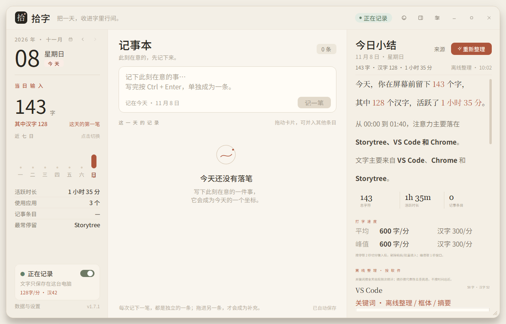
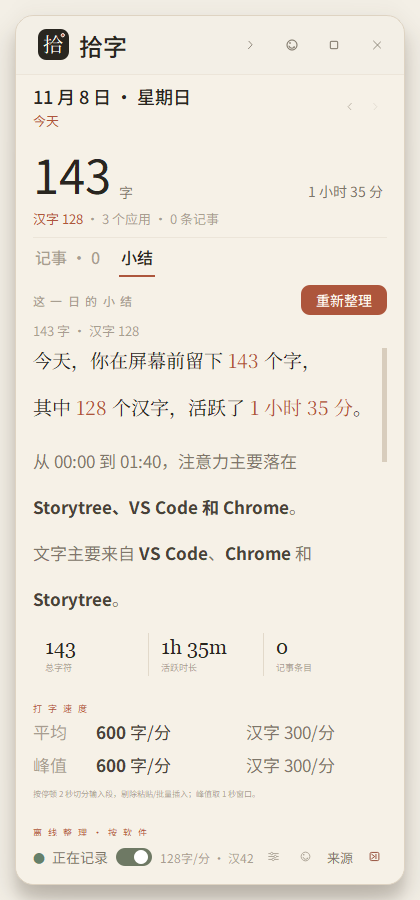
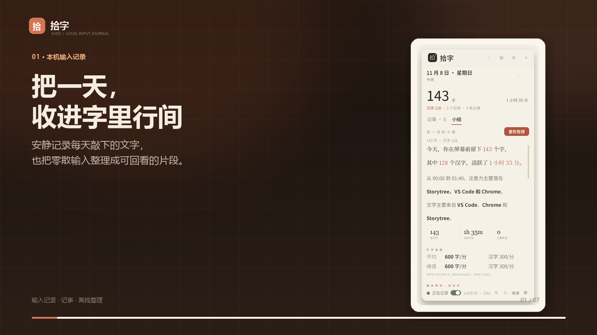
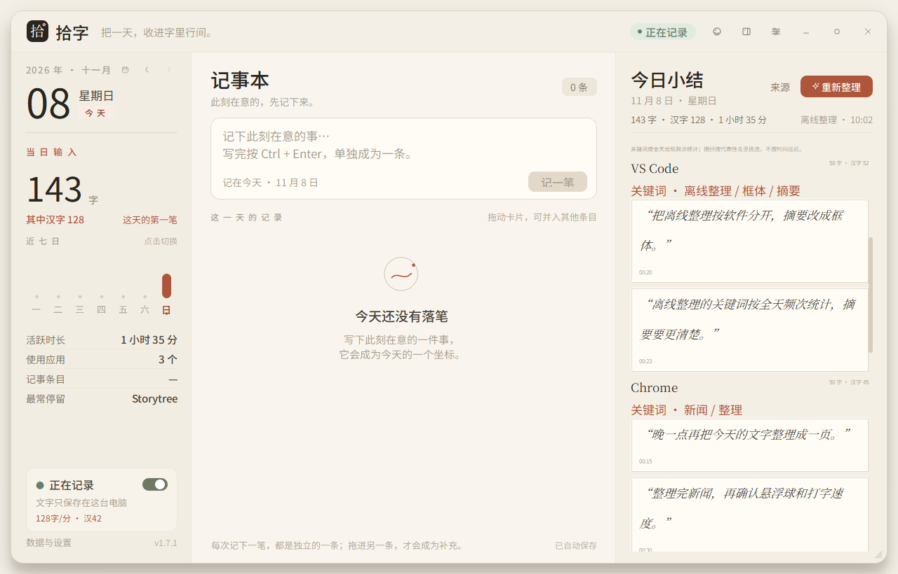
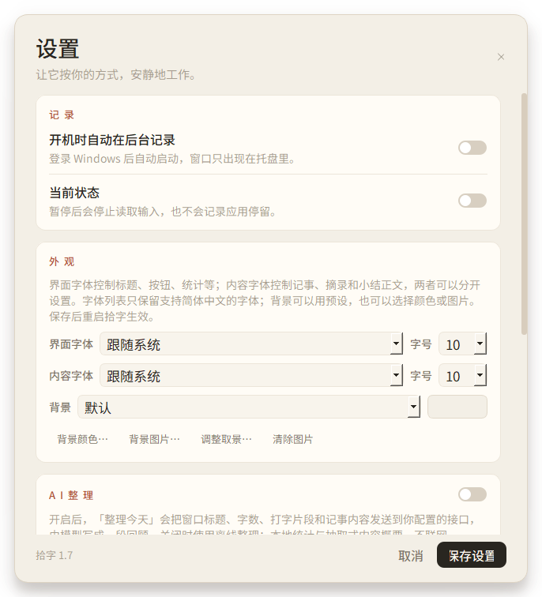
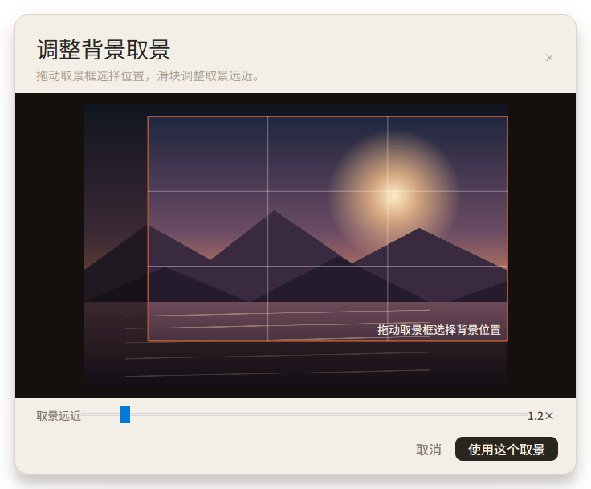

# Shizi — a quiet, local-first typing journal for Windows

**Keep a day in the space between characters.**

Shizi is a small Windows desktop app that quietly keeps a record of the text you type each day, shows where that text came from, and turns the day into a page you can read back. It is designed for people who write at a computer all day and want a private, searchable trace of their own words without a cloud account, a browser extension, or a screenshot archive.

The app is Chinese-first in its interface, but it records Chinese and Latin text alike. This repository distributes the English introduction and the ready-to-run **Shizi Lite** build.

## Download

| File | Size | Notes |
|---|---:|---|
| [`Shizi-Lite-v1.7.2-win64.zip`](Shizi-Lite-v1.7.2-win64.zip) | ~23 MB | Portable 64-bit Windows build. Unzip and run `Shizi-Lite.exe`. |
| [`Shizi-intro.mp4`](Shizi-intro.mp4) | ~1.7 MB | One-minute narrated overview. |

**Requirements:** Windows 10 or Windows 11, 64-bit. No installer, no Python, no administrator rights. The executable is unsigned, so Windows SmartScreen may ask you to confirm the first launch.



## What it does

### 1. A passive daily record of typed text

Shizi listens to ordinary keyboard input while it is running and stores the text in a local SQLite database. It also reads inserted text from Windows UI Automation so that Chinese IME output is captured correctly instead of being reduced to raw key codes.

- Total characters and Chinese characters are counted separately.
- Active typing time, applications used, and note count are summarised per day.
- Every captured burst keeps its source application and window title.
- The sidebar can stay docked at the edge of the screen like a compact companion, or expand into the full three-column window.



### 2. Know where each piece came from

Open **Sources** on a day to see which applications and windows contributed text. Source attribution is local and rule-based; it does not upload window titles anywhere.

### 3. Typing speed, in plain sight

- Live characters per minute and Chinese characters per minute, shown separately.
- A small always-on-top square ball can be dragged anywhere; it shows both speeds and never steals focus.
- Daily mean and peak speed are calculated with short pauses as boundaries.
- Speed display has a sanity guard of 1200 characters/min and 600 Chinese characters/min, so fast typing is not clipped at the old 600/300 limit.
- Very large paste events (>40 characters) are excluded from speed statistics so that a single paste does not distort the day.



### 4. Notes that stay independent

The notebook is deliberately not a chat log. Each note is saved as its own entry. If you want to attach a thought to an earlier note, drag one card onto another; only then does it become a supplement. Nothing is merged silently.

### 5. Offline daily summaries

The local summariser needs no network. It groups the day by application and selects representative passages using term frequency and repetition rather than an LLM.

- Per-application keywords chosen from the day's text.
- Short representative excerpts, shown in italic boxed quotations.
- A speed section with mean and peak values for characters and Chinese characters.
- Optional AI summaries work only if you explicitly enable them and configure an OpenAI-compatible endpoint; the app never sends text anywhere by default.



### 6. Appearance that reaches the whole window

- Separate **interface** and **content** font families and sizes, so labels can stay compact while notes and summaries become comfortable to read.
- Interface sizes 8–11 pt; content sizes 8–20 pt.
- Five built-in moods: Default, Deep Blue, Red & White, Sunny, and Night Neon (a black-to-deep-purple gradient).
- Built-in styles recolour the window chrome, panels, cards, buttons, and accents, not just the wallpaper.
- Custom background colour or image, with a draggable crop viewfinder and zoom.
- Changes take effect after restarting the app.





### 7. Privacy is the point

- Data stays in a local SQLite file. There is no account, no telemetry, and no sync service.
- Shizi does not take screenshots and does not read the clipboard.
- Password fields and known sensitive applications/windows are skipped.
- Recording can be paused instantly from the title bar, sidebar, or tray.
- The default data directory is `D:\shizi`; it can be changed in Settings, and existing data/backgrounds are copied when you move it.

## The Lite build

`Shizi-Lite.exe` keeps every product feature while removing Qt modules the app never loads: QML/Quick, SVG, DBus, Qt translations, the software OpenGL fallback, and unused platform/image plugins.

| Build | Size |
|---|---:|
| Standard `Shizi.exe` | ~38.4 MB |
| **Shizi Lite** | **~22.7 MB** |

The Lite and standard builds share the same data and settings. Do not run both at once; use one or the other.

## Getting started

1. Download and unzip `Shizi-Lite-v1.7.1-win64.zip`.
2. Run `Shizi-Lite.exe`. The first-run setup offers the default `D:\shizi` data location.
3. Leave the app running while you work. Use the tray menu to pause, open the full window, or enable the floating speed ball.
4. Open **Settings → Appearance** to change fonts, background, and theme.
5. Open a day and press **Organise today** to generate a local summary.

The app is intentionally quiet: no pop-ups while you type, no badges, no interruptions.

## Verify the download

`SHA256SUMS.txt` in the zip contains the SHA-256 of `Shizi-Lite.exe`. On Windows:

```powershell
Get-FileHash .\Shizi-Lite.exe -Algorithm SHA256
```

Compare the result with the checksum file before running the executable.

## Technical notes

- Python 3.9, PyQt5 5.15, SQLite, Windows UI Automation.
- Packaged as a single portable executable with PyInstaller.
- The keyboard hook is a low-level Windows hook; it never calls IME conversion APIs from inside the hook, which keeps typing responsive in other applications.
- The source is not included in this distribution repository. This repository is the download and documentation page for the Lite build.

## Version

**v1.7.2** — raises the speed display guard from 600/300 to **1200 characters/min and 600 Chinese characters/min**, and keeps the compact sidebar speed label readable at four-digit values. Includes the v1.7.1 composer footer fix.

---

If Shizi is useful to you, the best thing you can do is keep a page of your own day. 

*Shizi (拾字) — literally “picking up characters.”*
